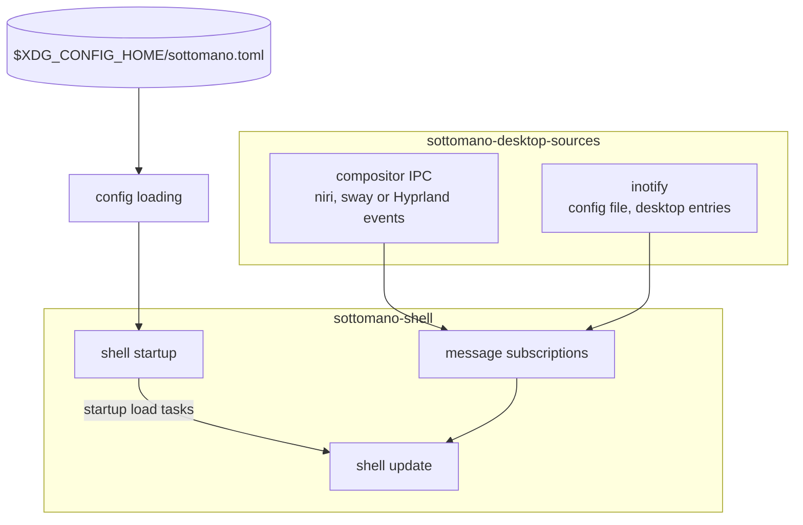
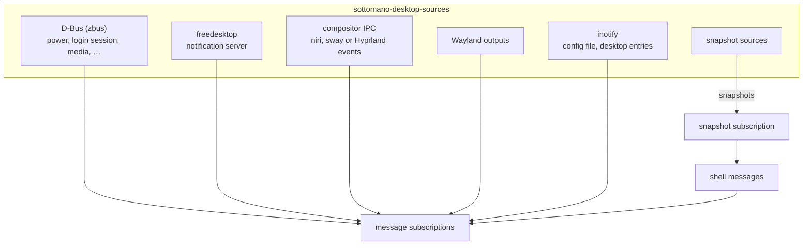
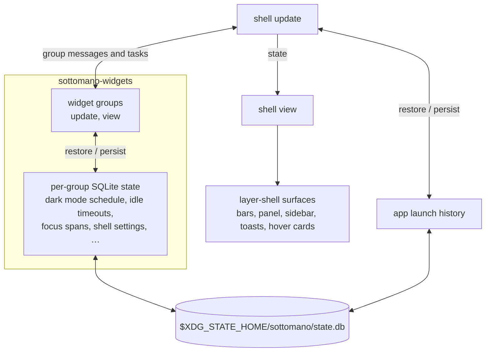
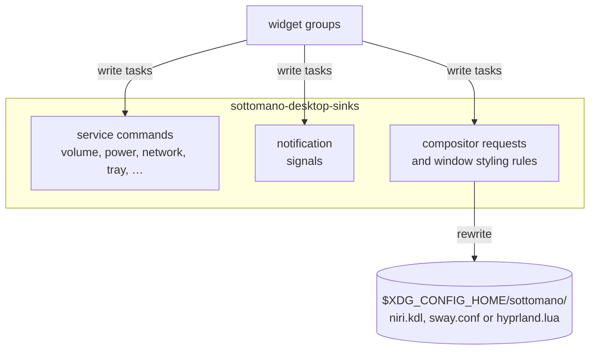

# Architecture

How sottomano's crates fit together and how the running shell works, one
diagram per flow. The workflow for building, debugging and testing it is in
[Development](development.md).

## Workspace

The repository is a cargo workspace:

- `sottomano-toml-config/` holds the TOML config types and their loading.
- `sottomano-desktop-sources/` holds the data sources the shell reads, as
  streams, together with the bus proxies and connection handles they share.
- `sottomano-desktop-sinks/` holds what the shell writes: commands, settings and
  signals sent to desktop services, built on the handles from the sources crate.
- `corredo/` holds generic iced widgets that know nothing about the shell.
- `sottomano-widgets/` holds the panels, group menus, widget groups, group items
  and hover cards, one module per level of the hierarchy in `CONTRIBUTING.md`.
  Each widget group restores and persists its own state.
- `sottomano-shell/` composes them into the running shell (binary `sottomano`)
  and defines the message type they produce.
- `sottomano-widget-showcase/` plays widget fixtures for the tour recordings,
  the `.ice` scenarios and the windowed tester.

## Startup

The shell loads the config and starts its daemon. A data source becomes a
subscription that yields a message while a reading it backs is on screen or can
alert, decided the same way for pinned groups and groups in a menu. Windows and
workspaces come from whichever compositor runs (niri, sway or Hyprland), detected
from its socket variable; each compositor sits behind a cargo feature of the
same name, all on by default.

## Readings to messages

Every live reading arrives as a message from a subscription: D-Bus services,
the notification server, compositor events, Wayland outputs and file watches.
Snapshot sources instead yield whole widgets at once, for the tour recordings
and the windowed tester.

## Messages to screen and back

The update step applies each message, persisting state where needed, and the
view renders the layer-shell surfaces. Each widget group updates and views its
own items, restoring and persisting its state in the per-group SQLite database.

## Writes to the desktop

The write tasks the widget groups produce go through the sinks crate: service
commands and notification signals, and the compositor requests that rewrite the
running compositor's window styling rule file, which each
[compositor's page](compositors/) includes in its config.

The CI pipelines and the tour recordings each have a diagram of their own in
[Development](development.md).