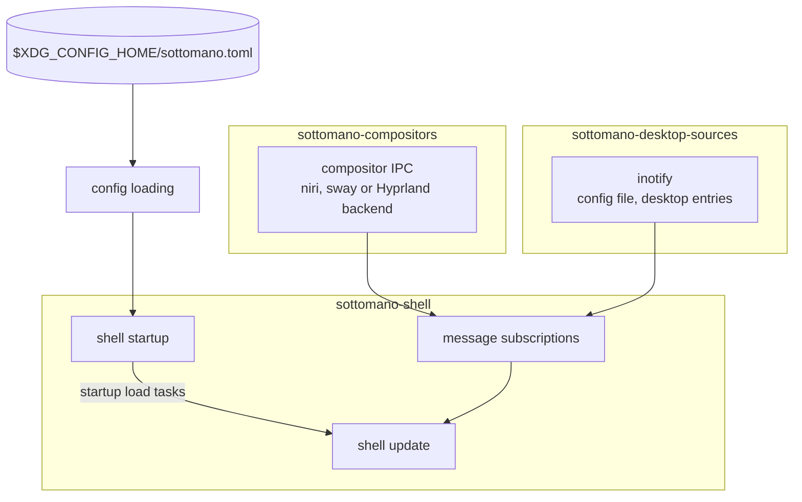
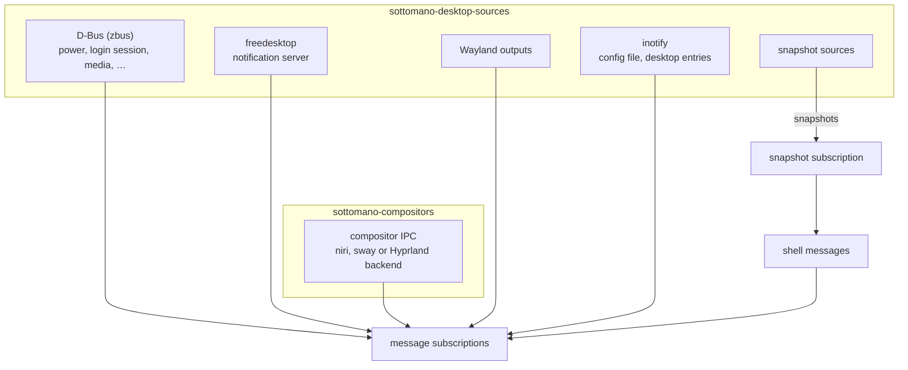
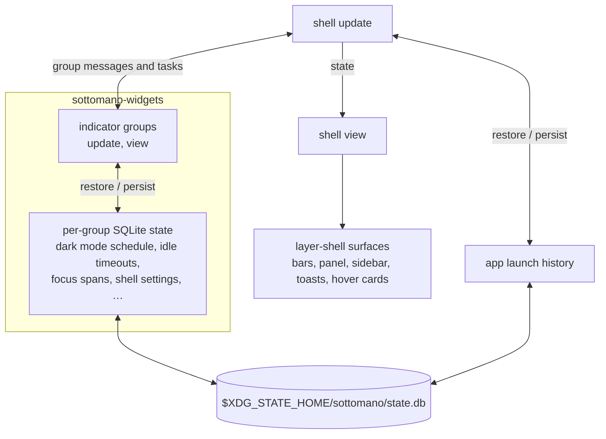
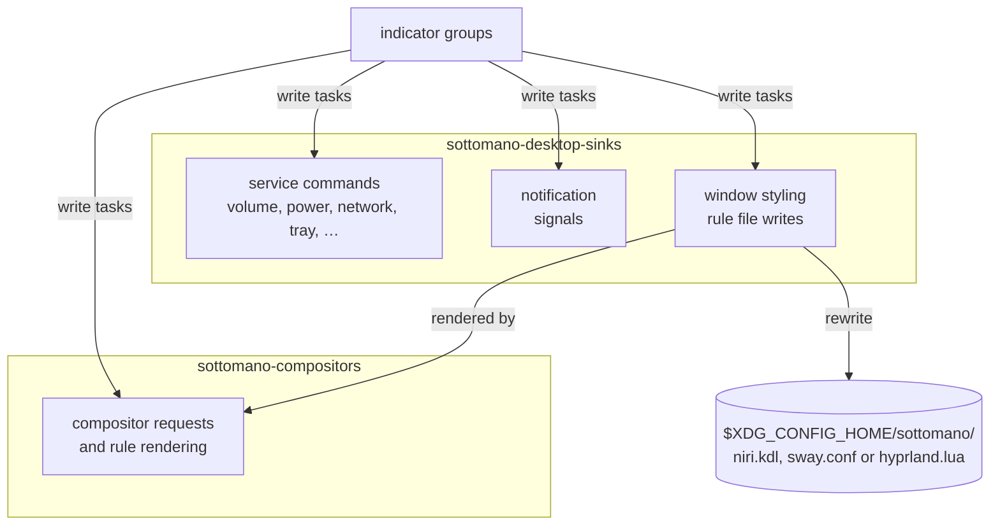

# Architecture

How sottomano's crates fit together and how the running shell works, one
diagram per flow. The workflow for building, debugging and testing it is in
[Development](development.md).

## Workspace

The repository is a cargo workspace:

- `sottomano-toml-config/` holds the TOML config types and their loading.
- `sottomano-compositor-model/` holds the compositor-neutral window, workspace,
  output, request and styling types, and the `CompositorBackend` trait every
  compositor implements.
- `sottomano-niri/`, `sottomano-hyprland/` and `sottomano-sway/` each implement
  `CompositorBackend` for one compositor: its IPC events and queries, its
  requests, its window styling rules and whatever only it supports. All
  compositor-specific code lives in these three crates.
- `sottomano-compositors/` detects the running compositor and dispatches to its
  backend. Other crates stay compositor-neutral by construction: none of them
  depends on a backend crate or an IPC library, `CompositorKind` keeps its
  variants private, and the `compositor-feature-cfg` ast-grep rule leaves the
  compositor features to this crate's dispatch.
- `sottomano-desktop-sources/` holds the data sources the shell reads, as
  streams, together with the bus proxies and connection handles they share.
- `sottomano-desktop-sinks/` holds what the shell writes: commands, settings and
  signals sent to desktop services, built on the handles from the sources crate.
- `corredo/` holds generic iced widgets that know nothing about the shell.
- `sottomano-widgets/` holds the panels, menus, groups, indicators and popups,
  laid out by the hierarchy in [Style](style.md#vocabulary).
  Each indicator group restores and persists its own state.
- `sottomano-shell/` composes them into the running shell (binary `sottomano`).
  The widgets crate defines the interactions its groups emit; the shell and the
  scenes crate each wrap them in their own message type.
- `sottomano-widget-scenes/` holds the widget fixtures and scenes, and the
  scripted session that plays steps on them, for the windowed tester, the UI
  regression tests and the `.ice` scenarios in `sottomano-widgets/tests/`.
- `sottomano-tour-recordings/` renders the demos of the guide and the README.

## Startup

The shell loads the config and starts its daemon. A data source becomes a
subscription that yields a message while a reading it backs is on screen or can
alert, decided the same way for pinned groups and groups in a menu. Windows and
workspaces come from whichever compositor runs (niri, sway or Hyprland), detected
by `sottomano-compositors` from its socket variable; each compositor's backend
crate sits behind a cargo feature of the same name, all on by default.

## Readings to messages

Every live reading arrives as a message from a subscription: D-Bus services,
the notification server, compositor events, Wayland outputs and file watches.
Snapshot sources instead yield whole widgets at once, for the tour recordings
and the windowed tester.

## Messages to screen and back

The update step applies each message, persisting state where needed, and the
view renders the layer-shell surfaces. Each indicator group updates and views its
own items, restoring and persisting its state in the per-group SQLite database.

## Writes to the desktop

The write tasks the indicator groups produce go through the sinks crate: service
commands, notification signals and the window styling rule file, which each
[compositor's page](compositors/) includes in its config. The running
compositor's backend renders the rules and carries out compositor requests.

The CI pipelines and the tour recordings each have a diagram of their own in
[Development](development.md).