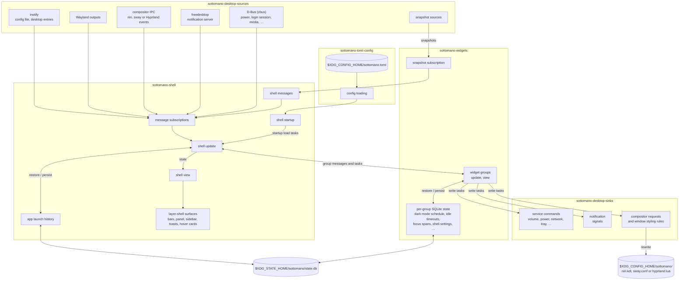
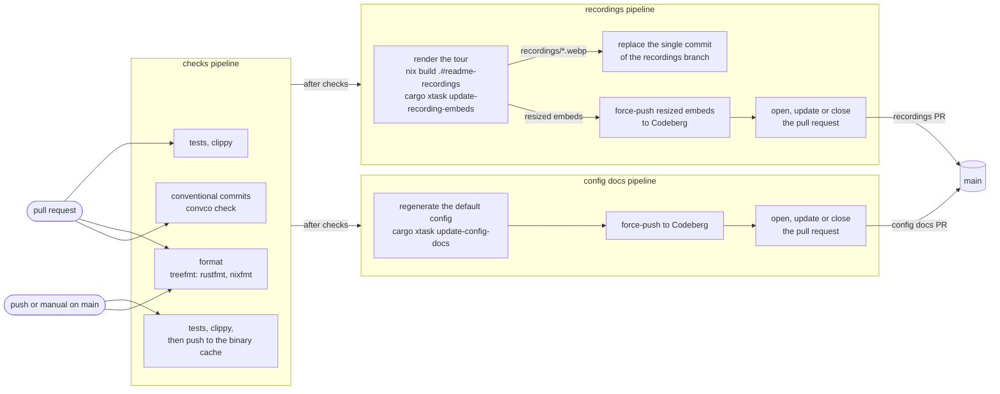
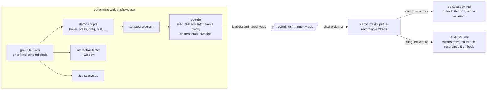

# Development

Setup and workflow for working on sottomano. The rules the code follows are in
[Style](style.md).

## Workspace

Work inside the Nix devshell (`nix develop`). The repository is a cargo
workspace:

- `sottomano-toml-config/` holds the TOML config types and their loading.
- `sottomano-desktop-sources/` holds the data sources the shell reads, as
  streams, together with the bus proxies and connection handles they share.
- `sottomano-desktop-sinks/` holds what the shell writes: commands, settings and
  signals sent to desktop services, built on the handles from the sources crate.
- `corredo/` holds generic iced widgets that know nothing about the shell.
- `sottomano-widgets/` holds the panels, group menus, widget groups, group items
  and hover cards, one module per level of the hierarchy in `CONTRIBUTING.md`.
  Each widget group restores and persists its own state.
- `sottomano-shell/` composes them into the running shell (binary `sottomano`)
  and defines the message type they produce.
- `sottomano-widget-showcase/` plays widget fixtures for the tour recordings,
  the `.ice` scenarios and the windowed tester.

## Runtime

The shell loads the config and starts its daemon. A data source becomes a
subscription that yields a message while a reading it backs is on screen or can
alert, decided the same way for pinned groups and groups in a menu. The update
step applies each message, persisting state where needed, and the view renders
the layer-shell surfaces. Windows and workspaces come from whichever compositor
runs (niri, sway or Hyprland), detected from its socket variable; each
compositor sits behind a cargo feature of the same name, all on by default.



## Building and checking

- `cargo r` for a debug run.
- `cargo clippy --workspace --all-targets` before committing. The workspace
  warns on clippy pedantic plus `absolute_paths`.
- `treefmt` formats Rust (rustfmt, nightly for the options in
  `.rustfmt.toml`) and Nix (nixfmt), as configured in `treefmt.toml`.
- `cargo xtask update-config-docs` regenerates the full default config in
  `docs/configuration.md`; with `--check` it only reports whether it is stale.

Version control is jj, not the `git` CLI.

## Debugging with comet

`cargo r --features devtools` attaches iced's devtools to the running shell, and
`--features time-travel` adds rewinding. The metrics show in comet, iced's
debugger window. The bar is a layer surface that never takes keyboard focus, so
devtools' F12 shortcut does not reach it. Start comet yourself:

```bash
cargo install --locked --git https://github.com/iced-rs/comet.git \
  --rev 3f75f3240edc1719df584810337bc7df010327d8
iced_comet &
cargo r --features devtools
```

The revision is the one the iced fork's devtools pins; bump it when the fork
moves. The shell's beacon keeps retrying its connection, so comet and the shell
can start in either order. Comet then shows each message with its update, view,
layout and draw timings, plus task and subscription counts; under `time-travel`
it can rewind the shell to an earlier message.

## CI

Woodpecker CI (`.woodpecker/`) builds the flake `checks` (tests, clippy and
format) on pull requests and on `main`. It also checks pull request commits
against Conventional Commits
(locally: `nix run --inputs-from . nixpkgs#convco -- check main..HEAD`). After
checks pass on `main`, the recordings pipeline re-renders the tour, force-pushes
it as the single commit of the orphan `recordings` branch and opens a pull
request when the embed widths changed. The config docs pipeline does the same
for the full default config in `docs/configuration.md` when the config crate
changes.



The recordings pipeline skips its own commits. The config docs pipeline only runs
when the config crate, `xtask/` or `docs/configuration.md` change, and skips its
own commits.

## VM tests

`vm-tests/` boots a NixOS VM per compositor (niri, sway, Hyprland) and scenario,
runs sottomano in a real session there and checks it through the compositor's
IPC and OCR of the screen. Each check is a flake check named
`vm-<compositor>-<scenario>`:

- `panel-mapped`: the bar starts and maps its panel.
- `styling-rules`: the bar writes the running compositor's rule file and the
  compositor accepts it.
- `workspace-follow`: named windows on two workspaces show in the bar after
  each workspace switch.

```bash
nix build .#checks.x86_64-linux.vm-sway-workspace-follow
nix run .#checks.x86_64-linux.vm-sway-workspace-follow.driverInteractive
```

The VMs need KVM and render in software. The niri in the VMs is patched to
accept a software renderer. The bar there uses a large font and a
high-contrast palette, so OCR reads it. A failing check prints the compositor's
windows and workspaces and the user journal.

The Woodpecker pipelines skip the VM tests. A Forgejo Actions workflow
(`.forgejo/workflows/vm-tests.yaml`) runs them on pushes to `main` on a runner
labelled `nix` with KVM.

## Tour recordings

The recordings in the [guide](guide/) and the README are rendered
offscreen by `sottomano-widget-showcase` into the untracked root `recordings/`.
`nix build .#readme-recordings` renders them all the way CI does.

```bash
cargo run -p sottomano-widget-showcase
cargo run -p sottomano-widget-showcase -- --jobs 2
cargo run -p sottomano-widget-showcase -- <demo-name>
cargo run -p sottomano-widget-showcase -- --window
```

Rendering every demo runs one child process per demo, `--jobs` at a time (4 by
default). A demo buffers its frames until it encodes them, so lower `--jobs` when
memory is short.



### Scripting a demo

Each demo shows one widget, is named `<group>_<widget>` and sits under its
heading on a page of `docs/guide/`, unless the README shows it. The name also
selects the iced preset that boots its fixture for the recorder, the `.ice`
scenarios and the windowed tester alike.

A demo names a fixture and a script of steps: hovering, pressing or dragging
named targets for panel widgets, and hovering or pressing visible text for
toasts, which a toast fixture serves when the demo starts. The recorder finds
each target on screen, plays the steps through `iced_test`'s emulator and writes
`recordings/<name>.webp`, a lossless animated WebP cropped in both directions to
what the demo shows, plus the panel gap as a margin. A group whose handle
previews one of its items is opened by pressing that item's target. A handle
without a preview is opened through the target for the group's face.

To add a demo, write a fixture for the group (fed its readings through its own
messages), add the group to the showcase's groups if it is not there yet, and
add the demo to the list of demos. A target that is not on screen fails the run
and lists the targets that are.

A demo can put several fixtures in one menu. The settings groups are shown with
their messages dropped, because those groups save to SQLite on update. Pressing
the pin of a menu row only changes the showcase's in-memory state.

### Reproducibility

Rendering twice gives identical files, which
`nix build .#readme-recordings --rebuild` verifies after a first build. Time is
data: every preset boots with a clock whose wall time is the fixed showcase
epoch, and the recorder advances that clock one frame interval per captured frame
and sends it as a message. The frame also rewrites the redraw instant iced hands
to widgets, so animations run from the same scripted time. Live readings, toast
expiry and the hover card hide timer fire when their deadline passes on that
clock, and the scripted program has no subscriptions.

Keep that property when writing fixtures and widgets: take the clock as an
argument, never read the system time (the widgets crate's clippy config forbids
it, also inside macros such as `vec!`), derive a fixture's sample index from the
clock, and return deadlines instead of starting timers. iced's own text input
blinks its cursor from the real clock, so no demo types into one.

### Windowed tester

`--window` opens the presets in a real window with the iced tester attached,
which switches between presets and records interactions as `.ice` scenarios.
Scenarios saved in the showcase crate's tests run with `cargo test` (and so in
CI); `expect` sees plain text widgets, not rich text such as toast bodies.

### Embedding recordings

The recordings are not part of `main`: CI publishes them as the single commit of
the orphan `recordings` branch, so the history of `main` stays free of media.
Each recording appears either in the root `README.md` (a few highlights) or on
a page of `docs/guide/` (the rest), as
`.webp" width="<w>">`.
`<w>` is the recording's cropped width in logical pixels, so all demos show at
the same scale. After rendering, `cargo xtask update-recording-embeds` rewrites
`<w>` from the files in `recordings/`; it fails with the expected tag only when a
recording is embedded nowhere. CI runs it right after the render.

Rendering every widget takes long, so each visually distinct kind of widget has
one demo, and widgets that look alike are listed in a table on the guide page
below it. The compute page opens with a two-column table: the group's menu demo
next to its pinned demo, which boots with that group pinned. Both images carry
`alt` before `width="100%"`, so the width rewrite leaves them alone and each fills
half the page. The canvas is transparent, so clear and translucent panels show
the page behind them.

## Documentation site

`docs/` is an mdBook published at [sottomano.work](https://sottomano.work); its
first page includes the root `README.md`. `mdbook serve docs` previews it
locally, and `nix build .#documentation-site` builds what the server hosts. The
site updates when the nuremberg host in nixos-config is rebuilt with a newer
sottomano input.

## Upstream docs

- [iced book](https://book.iced.rs/) and [API docs](https://docs.iced.rs/)
- [exwlshelleventloop](https://github.com/waycrate/exwlshelleventloop), the
  source of `iced_exwlshell` (and the fork carrying the active patches)
- [niri IPC](https://github.com/YaLTeR/niri) for the niri protocol
- [sway-ipc(7)](https://man.archlinux.org/man/sway-ipc.7) for the sway protocol
- [Hyprland IPC](https://wiki.hypr.land/IPC/) and its Lua dispatchers for Hyprland
- [zbus](https://dbus2.github.io/zbus/) for D-Bus data sources
