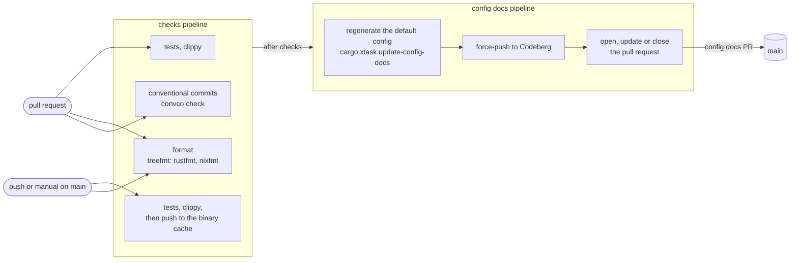
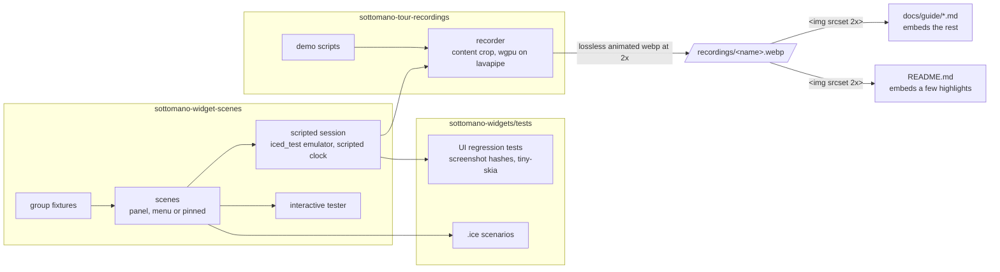

# Development

Setup and workflow for working on sottomano: building and checking it,
debugging, measuring its load, CI, the VM tests and the tour recordings. How the crates fit
together is in [Architecture](architecture.md); the rules the code follows are
in [Style](style.md).

Work inside the Nix devshell (`nix develop`).

## Building and checking

- `cargo r` for a debug run.
- `cargo clippy --workspace --all-targets` before committing. The workspace
  warns on clippy pedantic plus `absolute_paths`.
- `nix fmt` (or `treefmt` in the devshell) formats Rust (rustfmt, nightly for
  the options in `.rustfmt.toml`) and Nix (nixfmt), as configured in
  `flake-modules/formatting.nix`.
- Entering the devshell installs the git pre-commit hook defined in
  `flake-modules/git-hooks.nix`: treefmt and the ast-grep rules. CI runs the
  same hooks as `nix build .#checks.x86_64-linux.pre-commit`.
- `cargo xtask update-config-docs` regenerates the full default config in
  `docs/configuration.md`; with `--check` it only reports whether it is stale.

Version control is jj, not the `git` CLI.

## State database schema

Every table in `~/.local/state/sottomano/state.db` is defined in
the `sottomano-db-migrations` crate. A schema or data change is a new file
named `NNNN_what_changes.sql` with the next number in `db-migrations/sql/`,
registered in `db-migrations/src/lib.rs`; a test fails when a file is missing
there or out of order. Never edit a file
that has shipped: the database records the last applied number in
`PRAGMA user_version` and runs each newer file once, inside a transaction.

## Debugging with comet

`cargo r --features devtools` attaches iced's devtools to the running shell, and
`--features time-travel` adds rewinding. The metrics show in comet, iced's
debugger window. The bar is a layer surface that never takes keyboard focus, so
devtools' F12 shortcut does not reach it. Start comet yourself:

```bash
cargo install --locked --git https://github.com/iced-rs/comet.git \
  --rev 3f75f3240edc1719df584810337bc7df010327d8
iced_comet &
cargo r --features devtools
```

The revision is the one the iced fork's devtools pins; bump it when the fork
moves. The shell's beacon keeps retrying its connection, so comet and the shell
can start in either order. Comet then shows each message with its update, view,
layout and draw timings, plus task and subscription counts; under `time-travel`
it can rewind the shell to an earlier message.

## Measuring CPU, memory and wakeups

The shell reports its own load in the log, at debug level, when it receives
`SIGUSR1`, and once more when it stops on `SIGTERM` or `SIGINT`:

```sh
RUST_LOG=sottomano_shell=debug cargo r
kill -USR1 $(pgrep -x sottomano)
```

Each report covers the time since the previous report, or since the shell
started, and has two events:

- `process memory`: resident, anonymous, file-backed, swapped and peak memory
  in KiB, and the thread count, read from `/proc/self/status`.
- `process load`, with `window_seconds` for the time it covers:
  - `process_cpu_percent`: CPU time of all threads as a percentage of one core.
  - `busiest_threads`: CPU per thread name, read from `/proc/self/task`, so
    tokio workers, blocking threads and the UI thread show up separately.
  - `updates` and `busiest_updates`: how many messages `update` handled, and
    per message kind (for example `Message::Compute` or
    `GroupInteraction::Weather`) how often it ran and how long it took in
    total. Every message wakes the UI thread, so a kind with many runs keeps
    the laptop out of idle even when each run is short.
  - `views`: how often `view` built a widget tree and how long that took. It
    does not include iced's layout and drawing.
  - `busiest_sources`: per snapshot source, how often its stream was polled,
    how long the polls took and how many snapshots it delivered.

Build with `--features allocation-tally` to add allocation counts and bytes to
the update, view and source totals:

```sh
RUST_LOG=sottomano_shell=debug cargo r --features allocation-tally
```

The counter is process-wide, so allocations by other threads during an update
are counted towards that update too.

For a timeline of single updates, views and source polls, set
`SOTTOMANO_TRACE_FILE` to a path; the shell then writes a Chrome trace there,
which [Perfetto](https://ui.perfetto.dev) opens. `SOTTOMANO_TRACE_FILTER`
chooses which spans it records, in `RUST_LOG` syntax. Each source poll runs in
a `snapshot_source` span named after its source. The `update` span, which
carries the message kind, and the `view` span are at trace level, so include
them explicitly:

```sh
SOTTOMANO_TRACE_FILE=/tmp/sottomano-trace.json \
SOTTOMANO_TRACE_FILTER=error,sottomano_shell=trace,sottomano_widgets=debug \
  cargo r
```

## CI

Woodpecker CI (`.woodpecker/`) builds the flake `checks` (tests, clippy and
the pre-commit hooks) on pull requests and on `main`. Its steps run the Nushell
scripts in `ci/` inside the `ci` devshell (`ci-cargo` adds the Rust toolchain
and release-plz), so any step runs locally the same way. It also checks pull
request commits against Conventional Commits (locally:
`nix develop .#ci --command ci/release-tasks.nu check-commit-messages main..HEAD`). After
checks pass on `main`, the config docs pipeline regenerates the full default
config in `docs/configuration.md` when the config crate changes and opens a pull
request with it. CI does not render the tour recordings; deploying the
documentation site does (see [Embedding recordings](#embedding-recordings)).



The config docs pipeline only runs when the config crate, `xtask/` or `docs/configuration.md` change, and skips its
own commits.

## VM tests

`vm-tests/` boots a NixOS VM per compositor (niri, sway, Hyprland) and scenario,
runs sottomano in a real session there and checks it through the compositor's
IPC and OCR of the screen. Every directory in `vm-tests/` with a `check.py` is
a scenario that runs once per compositor; the flake check `vm-<compositor>`
runs all scenarios of that compositor:

- `panel-mapped`: the bar starts and maps its panel.
- `styling-rules`: the bar writes the running compositor's rule file and the
  compositor accepts it.
- `workspace-follow`: named windows on two workspaces show in the bar after
  each workspace switch.

```bash
nix build .#checks.x86_64-linux.vm-sway
nix build .#vm-tests.sway.workspace-follow
nix run .#vm-tests.sway.workspace-follow.driverInteractive
```

The VMs need KVM and render in software. The niri in the VMs is patched to
accept a software renderer. The bar there uses a large font and a
high-contrast palette, so OCR reads it. A failing check prints the compositor's
windows and workspaces and the user journal.

The Woodpecker pipelines skip the VM tests. A Forgejo Actions workflow
(`.forgejo/workflows/vm-tests.yaml`) runs them on pushes to `main` on a runner
labelled `nix` with KVM.

## Scenes, recordings and UI regression tests

Three places share the widget fixtures:

- `sottomano-widget-scenes` holds the fixtures and the scenes. A scene is a group
  with its fixture readings, shown on the panel, in a menu or pinned. The crate also
  holds the script steps (hover, press, drag, rest, …) and `ScriptedSession`, which
  boots a scene in `iced_test`'s emulator on a scripted clock and plays steps.
- `sottomano-tour-recordings` holds the demos, each a scene plus a script, and
  renders them into the recordings of the guide and the README.
- `sottomano-widgets/tests/` holds the UI regression tests, which play their own
  steps on the same scenes.

## Tour recordings

The recordings in the [guide](guide/) and the README are rendered
offscreen by `sottomano-tour-recordings` into the untracked root `recordings/`.
`nix build .#showcase-recordings` renders them the way the documentation site
build does, one demo per four build cores with four lavapipe threads each. Its source is
only the crates the recordings link, the workspace manifests and `.cargo/`;
`sottomano-shell` and `xtask` contribute their `Cargo.toml` (which takes part in
workspace feature unification) and empty targets. Changes to the shell, xtask,
the docs, the widget crate's tests or nix code that does not define the
recordings keep the cached recordings.

```bash
cargo run -p sottomano-tour-recordings
cargo run -p sottomano-tour-recordings -- --jobs 2
cargo run -p sottomano-tour-recordings -- <demo-name> <demo-name>
```

Every demo renders in a child process of its own, `--jobs` at a time (one per
four cores by default). A demo buffers its frames until it encodes them, up to 2 GB,
so lower `--jobs` when memory is short. Each recording holds its final state for two
seconds before the pointer clicks away and the loop restarts.



### Scripting a demo

Each demo shows one indicator, is named `<group>_<indicator>` and sits under
its group's heading on its menu's page in `docs/guide/`, unless the README
shows it.

A demo names a scene and a script of steps: hovering, pressing or dragging
named targets for panel widgets, and hovering or pressing visible text for
toasts, which a toast fixture serves when the scene boots. The recorder finds
each target on screen, plays the steps through `iced_test`'s emulator and writes
`recordings/<name>.webp`, a lossless animated WebP cropped in both directions to
what the demo shows, plus the panel gap as a margin. A group whose handle
previews one of its items is opened by pressing that item's target. A handle
without a preview is opened through the target for the group's face.

To add a demo, write a fixture for the group (fed its readings through its own
messages), add a scene that shows it unless one already does, and add the demo
to the list of demos. A target that is not on screen fails the run and lists the
targets that are. Each scene's name selects the iced preset that boots it for the
recorder, the regression tests, the `.ice` scenarios and the windowed tester alike.

A fixture can answer a press with new readings, delivered shortly after it, so a
switch in a demo shows its new state. A scene can put several fixtures in one menu. The settings groups are shown with
their messages dropped, because those groups save to SQLite on update. Pressing
the pin of a menu row only changes the scene's in-memory state.

### Reproducibility

Rendering twice gives identical files, which
`nix build .#showcase-recordings --rebuild` verifies after a first build. Time is
data: every preset boots with a clock whose wall time is the fixed showcase
epoch. The scripted session advances that clock's instant one frame interval per
frame, keeps its wall time fixed, and sends it as a message. The frame also
rewrites the redraw instant iced hands to widgets, so animations run from the
same scripted time. Live readings, toast expiry and the hover card hide timer
fire when their deadline passes on that clock, and the scripted program has no
subscriptions.

Keep that property when writing fixtures and widgets: take the clock as an
argument, never read the system time (the widgets crate's clippy config forbids
it, also inside macros such as `vec!`), derive a fixture's sample index from the
clock, and return deadlines instead of starting timers. iced's own text input
blinks its cursor from the real clock, so no demo types into one.

### UI regression tests

`sottomano-widgets/tests/ui_regressions/` has one module per UI part: toasts,
group menus, hover cards, panel faces and the bottom panel. Each test boots a
scene, plays a few steps and compares the SHA-256 of the screenshot with
`snapshots/<renderer>/<part>/<name>.sha256` next to the tests. A missing hash
file is written and the test passes, so after an intended change, delete the
hash files the failure names and run the tests again. A failure names the file
and the scene, so render the demo of that scene to see what changed.

```bash
cargo test -p sottomano-widgets --test ui_regressions
cargo test -p sottomano-widgets --test ui_regressions toasts
```

`.cargo/config.toml` sets `ICED_TEST_BACKEND=tiny-skia`, which `iced_test`'s
emulator reads (through the iced fork), so the tests render on the CPU and run in
parallel. The recordings binary sets `ICED_TEST_BACKEND=wgpu` for the child
processes it renders in, because only wgpu draws the backdrop blur.

### Windowed tester

`cargo run -p sottomano-widget-scenes` opens the scenes in a real window with
the iced tester attached, which switches between presets and records
interactions as `.ice` scenarios. Scenarios saved in
`sottomano-widgets/tests/ice/<part>/` run with `cargo test` (and so in CI), one
test per directory; `expect` sees plain text widgets, not rich text such as
toast bodies.

### Embedding recordings

The recordings are not part of `main`, so its history stays free of media. They
are rendered when the documentation site is built, which happens when nuremberg
is deployed, and sottomano.work serves them, also to the markdown read on
Codeberg.
Each recording appears either in the root `README.md` (a few highlights) or on
a page of `docs/guide/` (the rest), as
`.webp" srcset="https://sottomano.work/recordings/<name>.webp 2x" alt="…">`.
The recordings are rendered at twice their logical size, and the `2x` descriptor
makes the browser show them at their logical size, so all demos show at the same
scale without a width in the markdown. Rendering into the root `recordings/`
lets you preview them with `mdbook serve`:

```bash
nix build .#showcase-recordings
nix develop .#ci --command ci/nix-built-paths.nu copy-build-output result .
```

Each visually distinct kind of indicator has one demo, and every indicator is
listed in its group's table on the guide page. The canvas is transparent, so
clear and translucent panels show the page behind them.

## Documentation site

`docs/` is an mdBook published at [sottomano.work](https://sottomano.work); its
first page includes the root `README.md`. The mermaid diagrams render through
the `mdbook-mermaid` preprocessor, whose `install` subcommand adds the bundled
`mermaid.min.js` and `mermaid-init.js` to the book and the
`[preprocessor.mermaid]` entry to `book.toml` (the nix build runs it on a copy;
run it once yourself at the repo root before `mdbook serve`, which serves the
book from there too). `mdbook serve` previews it locally, and `nix build .#documentation-site` builds what the server hosts. The
site updates when the nuremberg host in nixos-config is rebuilt with a newer
sottomano input.

The build rewrites the Codeberg logo URL and the absolute
`https://sottomano.work/` links (the recordings among them) to site paths, and links `recordings/` to the
output of `.#showcase-recordings`, so the pages and their recordings come from the
same commit. It then checks every link offline with lychee, heading anchors
included, and fails on a missing page, anchor or recording. Building the site
therefore renders `.#showcase-recordings` unless it is already in the store.

## Upstream docs

- [iced book](https://book.iced.rs/) and [API docs](https://docs.iced.rs/)
- [exwlshelleventloop](https://github.com/waycrate/exwlshelleventloop), the
  source of `iced_exwlshell` (and the fork carrying the active patches)
- [niri IPC](https://github.com/YaLTeR/niri) for the niri protocol
- [sway-ipc(7)](https://man.archlinux.org/man/sway-ipc.7) for the sway protocol
- [Hyprland IPC](https://wiki.hypr.land/IPC/) and its Lua dispatchers for Hyprland
- [zbus](https://z-galaxy.github.io/zbus/) for D-Bus data sources
