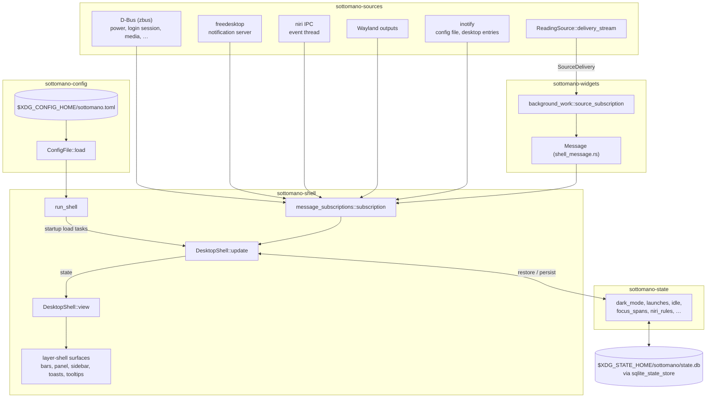
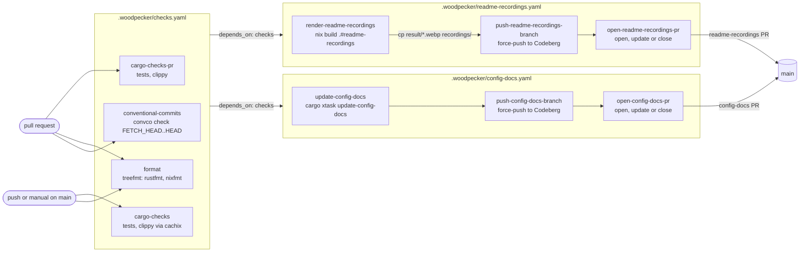
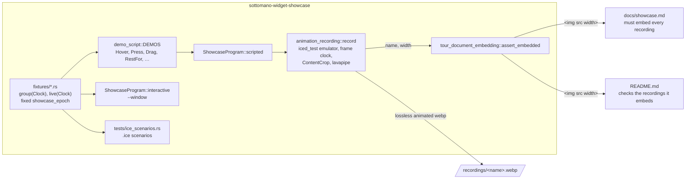

# Development

Setup and workflow for working on sottomano. The rules the code follows are in
[CONTRIBUTING.md](../CONTRIBUTING.md).

## Workspace

Work inside the Nix devshell (`nix develop`). The repository is a cargo
workspace:

- `sottomano-config/` holds the TOML config types and their loading.
- `sottomano-sources/` holds the data sources and sinks the shell reads and
  writes.
- `sottomano-state/` holds the runtime state the shell persists and restores.
- `sottomano-widgets/` holds the widgets, widget groups, hover tooltips and the
  `Message` they produce.
- `sottomano-shell/` composes them into the running shell (binary `sottomano`).
- `sottomano-widget-showcase/` plays widget fixtures for the tour recordings,
  the `.ice` scenarios and the windowed tester.

## Runtime

`run_shell` loads the config and starts the `DesktopShell` daemon. Every data
source becomes a subscription that yields a `Message`. `update` applies it,
persisting state where needed, and `view` renders the layer-shell surfaces.

## Building and checking

- `cargo r` for a debug run.
- `cargo clippy --workspace --all-targets` before committing. The workspace
  warns on clippy pedantic plus `absolute_paths`.
- `treefmt` formats Rust (rustfmt, nightly for the options in
  `.rustfmt.toml`) and Nix (nixfmt), as configured in `treefmt.toml`.
- `cargo xtask update-config-docs` regenerates the full default config in
  `docs/configuration.md`; with `--check` it only reports whether it is stale.

Version control is jj, not the `git` CLI.

Debugging the running shell with iced's devtools and comet is described in
[sottomano-shell/CONTRIBUTING.md](../sottomano-shell/CONTRIBUTING.md).

## CI

Woodpecker CI (`.woodpecker/`) builds the flake `checks` (tests, clippy and
format) on pull requests and on `main`. It also checks pull request commits
against Conventional Commits
(locally: `nix run --inputs-from . nixpkgs#convco -- check main..HEAD`). After
checks pass on `main`, the `readme-recordings` pipeline re-renders the tour and
opens a pull request when the recordings changed. The `config-docs` pipeline
does the same for the full default config in `docs/configuration.md` when the
config crate changes.

The `readme-recordings` pipeline skips pushes that only touch `recordings/**`
and its own commits. The `config-docs` pipeline only runs when
`sottomano-config/`, `xtask/` or `docs/configuration.md` change, and skips its
own commits.

## Tour recordings

The recordings in [showcase.md](showcase.md) and the README are rendered by
`sottomano-widget-showcase`.
[sottomano-widget-showcase/CONTRIBUTING.md](../sottomano-widget-showcase/CONTRIBUTING.md)
describes how they are scripted, added and checked.

## Upstream docs

- [iced book](https://book.iced.rs/) and [API docs](https://docs.iced.rs/)
- [exwlshelleventloop](https://github.com/waycrate/exwlshelleventloop), the
  source of `iced_exwlshell` (and the fork carrying the active patches)
- [niri IPC](https://github.com/YaLTeR/niri) for the compositor protocol
- [zbus](https://dbus2.github.io/zbus/) for D-Bus data sources
